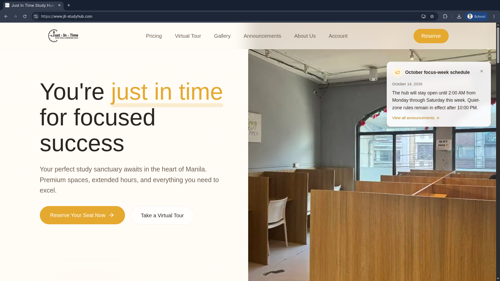
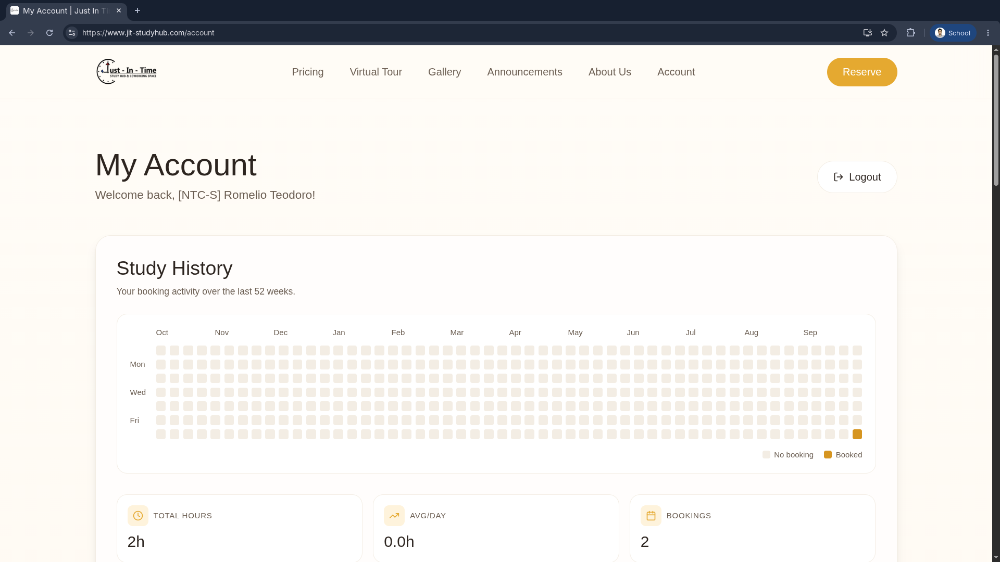
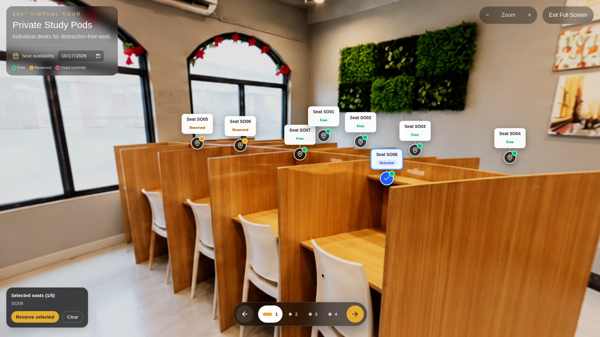
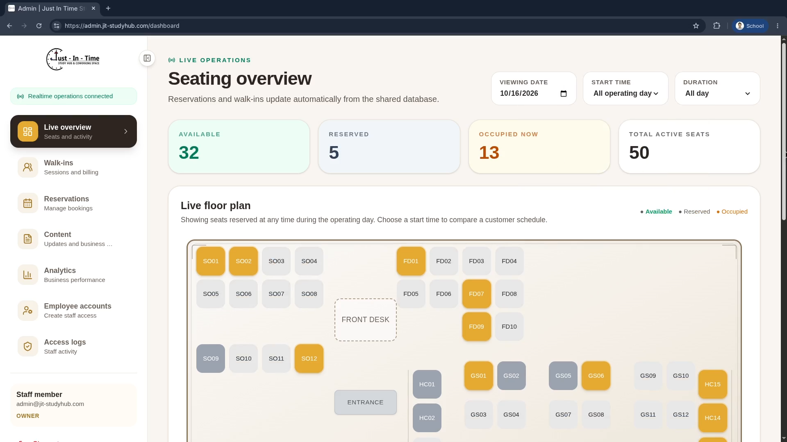
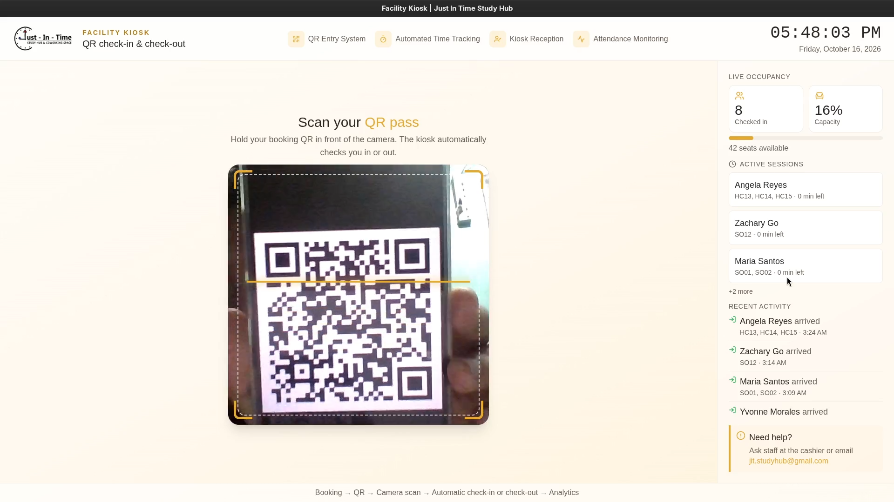
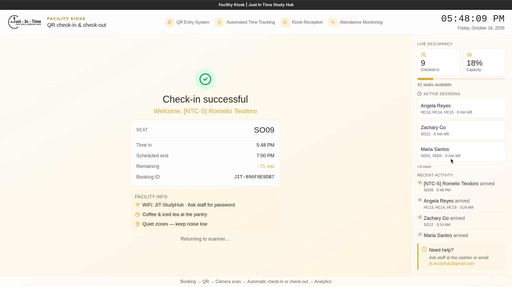
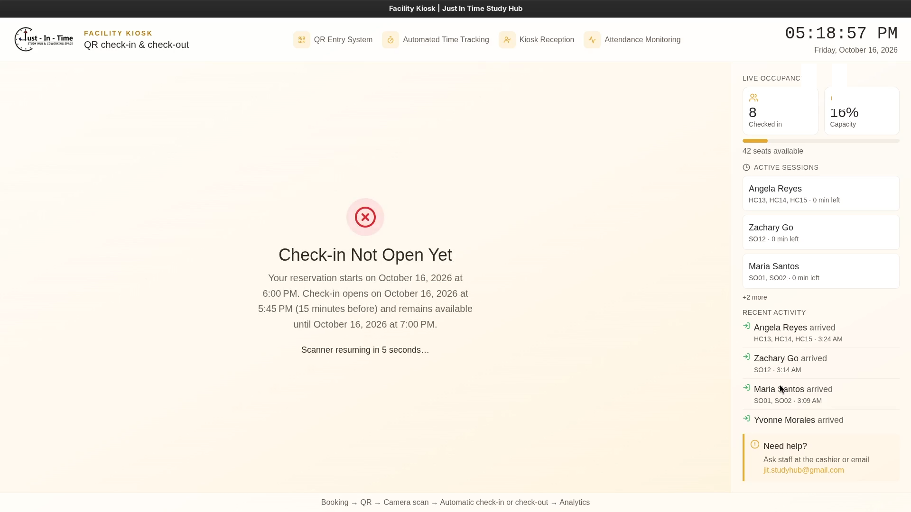
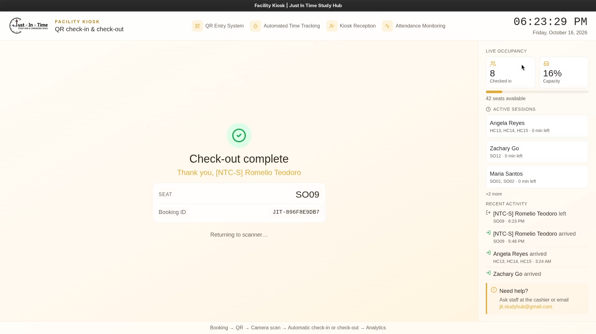

# Just In Time Study Hub and Coworking Space

[](https://www.youtube.com/watch?v=4nLBV7w_NfQ)

> [!NOTE]
> This repository is an npm workspace containing two web applications and one
> Electron kiosk, all backed by one Supabase project.

## Screenshots

### Public website







### Admin dashboard



### Facility kiosk









```text
studyhub/
├── frontend/    Public customer website; deploy to jit-studyhub.com
├── admin/       Staff dashboard; deploy to admin.jit-studyhub.com
├── kiosk/       Electron front-desk QR scanner; install only at the facility
└── supabase/    Shared database migrations, tests, seed data, and local config
```

```text
Public Next.js (Vercel) ──┐
Admin Next.js (Vercel) ───┼── Supabase Auth, Data API, Postgres, Storage, RLS
Electron kiosk (local) ───┘
```

## Setup

Complete setup, environment, architecture, and operational guidance is
available in the [project documentation](docs/README.md).

Requirements: Node.js 24.x, npm, and a running Docker installation for
the local development database. See [Getting started](docs/GETTING_STARTED.md#install-docker)
for Docker Desktop and Docker Engine installation instructions for macOS,
Windows, and Linux.

Install all workspace dependencies once from the repository root:

```bash
npm install
```

Each app loads environment variables from its own directory:

```bash
cp frontend/.env.example frontend/.env.local
cp admin/.env.example admin/.env.local
cp kiosk/.env.example kiosk/.env.local
```

Add the same Supabase URL and publishable key to all three files. The frontend
and admin also require their app-specific site URL shown in each example file.

Start the public site:

```bash
npm run dev:frontend
```

Start the admin application in a second terminal:

```bash
npm run dev:admin
```

Build and open the facility kiosk desktop app:

```bash
npm run desktop:kiosk
```

Open <http://localhost:3000> for the public site and
<http://127.0.0.1:3001> for admin. The kiosk opens in its own full-screen
desktop window.

## Supabase

The root `supabase/` directory remains the single backend source of truth for all applications:

```bash
npm run supabase:start
npm run supabase:reset
npm run supabase:types
```

`supabase:types` generates the database types for the frontend and copies the same generated types into the admin application. The kiosk only uses the small API surface defined locally. See `supabase/README.md` for database testing, production deployment, Auth configuration, and administrator promotion.

## Checks and production builds

```bash
npm run lint
npm test
npm run build
```

The full suite also includes Playwright smoke tests for all three applications and
pgTAP coverage for the schema and RLS rules. See the
[testing guide](docs/TESTING.md) for setup and commands.

```bash
npm test               # frontend and admin unit tests
npm run test:frontend  # frontend only
npm run test:admin     # admin only
npm run test:db        # database and RLS tests (local Supabase required)
```

You can also check an individual app:

```bash
npm run build:frontend
npm run build:admin
npm run build:kiosk
```

To run local production builds:

```bash
npm run start:frontend
npm run start:admin
npm run start:kiosk
```

`start:kiosk` opens an existing desktop build. Use `npm run desktop:kiosk` when
the kiosk must be rebuilt first, or `npm run dist:kiosk:win` to create its
Windows installer. To produce both the Linux AppImage and Windows 10/11
installer in reproducible Linux-based build containers, use
`npm run dist:kiosk:docker`; see the [kiosk packaging guide](kiosk/README.md#build-both-installers-with-docker).

## Capstone Group

This capstone project was developed by students from the National Teachers College:

- Barquez, Rafael C.
- De Vera, Jhan Nichol G.
- Teodoro, Romelio C.
- Rivera, Edmon Daniel C.
- Ronquillo, Vincent Raiven

_A.Y. 2026-2027_
