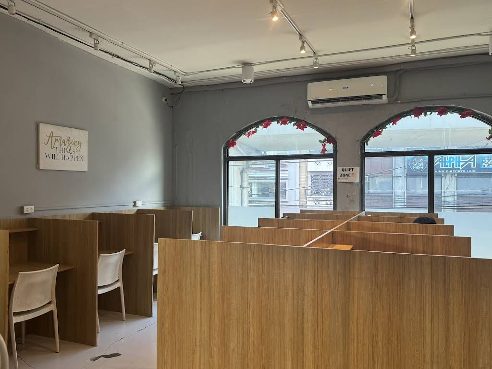

# Just In Time Study Hub and Coworking Space

_A modern study hub and coworking space experience built with Next.js._



## Overview

Just In Time Study Hub and Coworking Space is a responsive web app for a study and coworking venue in Manila. It highlights the space, key amenities, pricing, reservation flow, gallery, and virtual tour experience in a polished landing-page style interface.

## Features

- Homepage with a strong hero section and call to action
- Sections for venue highlights, features, pricing, and contact-oriented information
- Route pages for About, Account, Gallery, Login, Pricing, Register, Reserve, and Virtual Tour
- Built with reusable UI components and modern React patterns

## Tech Stack

- Next.js 16
- React 19
- TypeScript
- Tailwind CSS v4
- Radix UI components
- Lucide icons, Motion, and other supporting UI libraries
- Supabase Auth and Postgres with row-level security

## Project Structure

- `app/(client)/` contains the public website and its header/footer layout
- `app/(admin)/` contains the admin login and panel layouts
- `app/(kiosk)/` contains the isolated facility kiosk layout
- `app/components/` contains the reusable UI components that are shared across route groups
- `lib/` contains shared domain logic used by multiple route groups
- `public/images/` stores the image assets used throughout the site

Route groups organize the code without changing its URLs. For example, the admin
dashboard remains available at `/admin/dashboard` and the kiosk at `/kiosk`.

## Getting Started

### Prerequisites

- Node.js 20.9 or newer
- npm

### Install Dependencies

```bash
npm install
```

### Configure Supabase

Copy `.env.example` to `.env`, then add the project URL and publishable key from
the Supabase project dashboard. Apply the SQL migration in
`supabase/migrations/20260925000000_auth_and_bookings.sql` before using account
or booking features. See `supabase/README.md` for the authentication email
template and admin-role setup.

### Run the Development Server

```bash
npm run dev
```

Open [http://localhost:3000](http://localhost:3000) in your browser.

### Build for Production

```bash
npm run build
```

### Start the Production Server

```bash
npm run start
```

### Lint the Project

```bash
npm run lint
```
