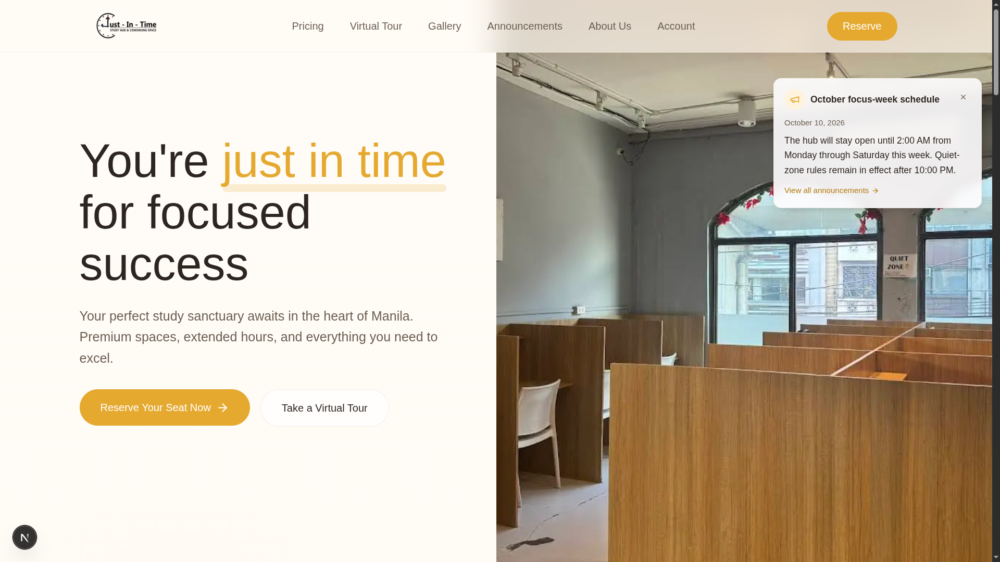

# Just In Time Study Hub and Coworking Space

This repository is an npm workspace containing two independent Next.js applications backed by one Supabase project.

## Preview



```text
studyhub/
├── frontend/    Public customer website; deploy this directory to Vercel
├── admin/       Admin dashboard and kiosk; run this only at the facility
└── supabase/    Shared database migrations, tests, seed data, and local config
```

```text
Public Next.js (Vercel) ──┐
                          ├── Supabase Auth, Data API, Postgres, Storage, RLS
Admin Next.js (local) ────┘
```

## Applications

### Public frontend

`frontend/` contains the customer-facing pages, including reservations, authentication, accounts, pricing, the gallery, and the virtual tour. It does not contain `/admin` or `/kiosk`, so those routes are absent from its production build.

For Vercel, import this repository and set **Root Directory** to `frontend`. Configure these variables in the Vercel project:

```text
NEXT_PUBLIC_SUPABASE_URL
NEXT_PUBLIC_SUPABASE_PUBLISHABLE_KEY
NEXT_PUBLIC_SITE_URL
```

Only use a Supabase publishable key in `NEXT_PUBLIC_` variables. Never place a secret or service-role key in either browser application.

### Facility operations

`admin/` contains:

- `/admin` and `/admin/dashboard` for authenticated administrators
- `/kiosk` for the on-site check-in interface

It is not connected to a Vercel project. Its development and production scripts bind to `127.0.0.1:3001`, making it reachable only from the facility computer.

Network isolation is an additional control. Admin authentication and Supabase RLS must remain enabled.

## Setup

Complete setup, environment, architecture, and operational guidance is
available in the [project documentation](docs/README.md).

Requirements: Node.js 22.12 or newer, npm, and a running Docker installation for
the local development database. See [Getting started](docs/GETTING_STARTED.md#install-docker)
for Docker Desktop and Docker Engine installation instructions for macOS,
Windows, and Linux.

Install all workspace dependencies once from the repository root:

```bash
npm install
```

Each app loads environment variables from its own directory:

```bash
cp frontend/.env.example frontend/.env.local
cp admin/.env.example admin/.env.local
```

Add the same Supabase URL and publishable key to both files. The frontend site URL is `http://localhost:3000`; the local operations site URL is `http://localhost:3001`.

Start the public site:

```bash
npm run dev:frontend
```

Start the facility application in a second terminal:

```bash
npm run dev:admin
```

Open <http://localhost:3000> for the public site and <http://127.0.0.1:3001> for facility operations.

## Supabase

The root `supabase/` directory remains the single source of truth for both applications:

```bash
npm run supabase:start
npm run supabase:reset
npm run supabase:types
```

`supabase:types` generates the database types for the frontend and copies the same generated types into the admin application. See `supabase/README.md` for database testing, production deployment, Auth configuration, and administrator promotion.

## Checks and production builds

```bash
npm run lint
npm test
npm run build
```

The full suite also includes Playwright smoke tests for both applications and
pgTAP coverage for the schema and RLS rules. See the
[testing guide](docs/TESTING.md) for setup and commands.

```bash
npm test               # frontend and admin unit tests
npm run test:frontend  # frontend only
npm run test:admin     # admin only
npm run test:db        # database and RLS tests (local Supabase required)
```

You can also check an individual app:

```bash
npm run build:frontend
npm run build:admin
```

To run local production builds:

```bash
npm run start:frontend
npm run start:admin
```
